# MCP-Enabled RAG Assistant

A production-ready, Model Context Protocol ([MCP](https://modelcontextprotocol.io)) compliant Retrieval-Augmented Generation (RAG) assistant designed for dense semantic search, neural reranking, and grounded question answering over technical and academic PDF documents.

The system exposes high-performance MCP tools over a secure JSON-RPC `stdio` transport interface, allowing any MCP host (such as Claude Desktop, Cursor, or MCP Inspector) to search, query, and index local document repositories with strict source attribution and hallucination safeguards.

---

## 1. Project Overview

### What the Project Does
This project provides an MCP server and RAG pipeline optimized for question answering across complex documents (e.g., machine learning texts, fluid dynamics research papers, combinatorics notes, and systems specifications). It indexes PDF documents into a local vector database, retrieves candidate passages via dense semantic search, optionally reranks them with a cross-encoder model, and synthesizes grounded answers using Groq-hosted LLMs with precise page citations.

### Problem It Solves
- **Standardized Agent Tooling**: Eliminates vendor lock-in and bespoke function-calling schemas by adhering directly to the Model Context Protocol specification.
- **Hallucination Mitigation**: Uses low-temperature generation, negative-constraint system prompts, and strict document-grounding instructions to prevent extrapolation.
- **Cross-Encoder Fragility on Math & Code**: Implements dynamic symbolic routing that detects mathematical notations and discrete equations, preventing tokenizer fragmentation in deep cross-encoders by routing directly to top dense candidates.
- **Transparent Attribution**: Mandates inline citation tags (`[Source: <file> | Page: <n>]`) for all retrieved context and generated answers.

### End-to-End Workflow
```
[User / MCP Host]
        │ (JSON-RPC stdio)
        ▼
[FastMCP Server] ──► [Query Classifier] ──► [ChromaDB Vector Store] (BGE-Small Embeddings)
                             │                                │ (Top-k Candidate Chunks)
                             ├─ If Symbolic/Math ─────────────┤ (Bypass Cross-Encoder)
                             └─ If Natural Language ──────────▼
                                                      [BGE Cross-Encoder Reranker]
                                                              │ (Top-k Reranked Chunks)
                                                              ▼
                                                      [Groq LLM Engine] (Qwen 3.8-27B)
                                                              │
                                                              ▼
                                                      [Grounded, Attributed Response]
```

---

## 2. Key Features

- **FastMCP Protocol Server**: Implements 4 distinct tools over `stdio` transport, maintaining protocol integrity by isolating runtime logs to `stderr`.
- **Deterministic Chunk Ingestion**: Ingests multi-page PDFs using `PyPDFLoader` and `RecursiveCharacterTextSplitter` (1500 chunk size, 250 chunk overlap), generating idempotent 12-character MD5 chunk hashes (`{source}_{hash}`) to prevent duplicate entries in ChromaDB.
- **Dense Vector Search**: Powered by `BAAI/bge-small-en-v1.5` (384 dimensions, contrastive L2 normalized, 64-chunk batching) stored in a persistent local ChromaDB collection (`pdf_knowledge_base`).
- **Dynamic Dual-Stage Reranking**: Utilizes `BAAI/bge-reranker-base` to rescore dense search candidates, paired with a regex/keyword classification gate (`is_math_or_symbolic`) that automatically bypasses reranking on formulas and combinatorics queries.
- **Lazy Initialization Safeguard**: Defers loading of heavy neural cross-encoders until the first inference call, ensuring instant MCP handshake startup without client timeouts.
- **Grounded Answer Synthesis**: Leverages Groq API with `qwen/qwen3.8-27b` (temperature: 0.2, max tokens: 600) with strict refusal rules if retrieved context lacks the answer.
- **Comprehensive Evaluation Suite**: Includes an empirical 50-query benchmarking harness with automated LLM-as-a-judge relevance labeling, measuring MRR, Recall@3, Recall@5, NDCG@10, and latency profiles.

---

## 3. System Architecture

### Pipeline Breakdown
1. **Document Ingestion**:
   - PDF files located in `data/` are loaded page-by-page via `PyPDFLoader`.
   - Text is partitioned into 1500-character chunks with a 250-character sliding window overlap across paragraph and line delimiters (`\n\n`, `\n`, `" "`, `""`).
   - Each chunk receives a deterministic unique identifier combining the source filename and an MD5 hash of the stripped text content.
   - Embeddings are generated in batches of 64 using `BAAI/bge-small-en-v1.5` and persisted locally in `chroma_db/`.
2. **Dense Retrieval (Stage 1)**:
   - Incoming user queries are embedded via `bge-small-en-v1.5` with L2 unit normalization.
   - ChromaDB computes cosine similarity over indexed chunks to retrieve top-$k$ candidates (default $k=10$ or $k=20$).
3. **Query Classification & Reranking (Stage 2)**:
   - The query passes through `is_math_or_symbolic`: queries matching discrete math keywords or containing 2+ symbolic operators (`+`, `-`, `*`, `/`, `=`, `^`, `[]`, `{}`, `()`) bypass the reranker.
   - Non-symbolic queries are paired with candidate chunks and rescored using `BAAI/bge-reranker-base` cross-encoder.
4. **Context Construction & Generation**:
   - The top-$k$ ranked chunks are assembled into formatted context blocks tagged with metadata: `[Source: <filename> | Page: <page_number>]`.
   - The prompt is dispatched to `qwen/qwen3.8-27b` via the Groq client to synthesize the final attributed response.

```mermaid
flowchart TD
    subgraph Ingestion["Offline Ingestion Pipeline"]
        PDF["PDF Documents (data/)"] --> Loader["PyPDFLoader"]
        Loader --> Splitter["RecursiveCharacterTextSplitter\n(Chunk: 1500, Overlap: 250)"]
        Splitter --> Hash["Deterministic MD5 Hash Key\n({source}_{hash})"]
        Hash --> EmbedModel["BAAI/bge-small-en-v1.5\n(Normalized, 384-dim)"]
        EmbedModel --> VectorStore[("ChromaDB\n(pdf_knowledge_base)")]
    end

    subgraph Serving["Online MCP RAG Pipeline"]
        Host["MCP Host (Claude / Cursor / Inspector)"] -- "JSON-RPC (stdio)" --> Server["FastMCP Server (server.py)"]
        Server --> Tools{"MCP Tool"}
        
        Tools -- "search_documents / ask_document_question" --> Dense["Dense Retrieval\n(ChromaDB Top-K Candidates)"]
        Dense --> Classifier{"is_math_or_symbolic(query)"}
        
        Classifier -- "Yes (Math / Symbolic)" --> Bypass["Bypass Cross-Encoder\n(Preserves token precision)"]
        Classifier -- "No (Text Query)" --> Reranker["Cross-Encoder Reranker\n(BAAI/bge-reranker-base)"]
        
        Bypass --> Context["build_context()\n[Source: file | Page: n]"]
        Reranker --> Context
        
        Context --> ToolChoice{"Tool Target"}
        ToolChoice -- "search_documents" --> FormattedCtx["Return Formatted Context"]
        ToolChoice -- "ask_document_question" --> GroqLLM["Groq API\n(qwen/qwen3.8-27b, temp=0.2)"]
        
        GroqLLM --> GroundedResp["Grounded Attributed Answer"]
        FormattedCtx --> Host
        GroundedResp --> Host
        
        Tools -- "index_documents" --> IngestTrigger["Trigger ChromaDB Ingestion"]
        Tools -- "list_available_documents" --> DocList["List PDF Files"]
    end
```



---

## 4. Tech Stack

| Layer | Component / Library | Details / Rationale |
| :--- | :--- | :--- |
| **Protocol / Transport** | `fastmcp` (v0.1.0+) | Model Context Protocol implementation running over `stdio` transport |
| **Vector Store** | `chromadb` (v0.5.0+), `langchain-chroma` | Embedded persistent vector database storing L2-normalized embeddings |
| **Document Processing** | `pypdf`, `langchain-text-splitters`, `langchain-community` | PDF text extraction and recursive hierarchical chunking |
| **Embedding Model** | `BAAI/bge-small-en-v1.5` via `langchain-huggingface` | 33.4M parameters, 384 dimensions, normalized embeddings on CPU |
| **Reranker Model** | `BAAI/bge-reranker-base` via `sentence-transformers` | Cross-encoder architecture rescoring query-passage token interactions |
| **LLM Inference** | `groq` (v0.9.0+) | Groq Cloud SDK serving `qwen/qwen3.8-27b` at low latency |
| **Deep Learning Framework**| `torch` (v2.2.0+), `transformers` (v4.40.0+) | Backend inference runtime for Hugging Face transformer models |
| **Evaluation & Math** | `numpy` | Vector mathematics, Cosine Similarity, MRR, Recall@k, and DCG/NDCG |
| **Configuration / Runtime** | `python-dotenv`, `uvicorn`, Python 3.11 | Environment secret management and container runtime |

---

## 5. Project Structure

```
.
├── Dockerfile                   # Multi-stage container definition for running the server on Python 3.11-slim
├── requirements.txt             # Pinned project dependencies
├── server.py                    # FastMCP server defining search, QA, indexing, and document listing tools
├── data/                        # Local repository for source PDF documents
├── rag/                         # Core Retrieval-Augmented Generation package
│   ├── __init__.py              # Package marker
│   ├── embeddings.py            # HuggingFace BAAI/bge-small-en-v1.5 embedding initialization
│   ├── generation.py            # Groq Qwen 3.8-27B generation with grounding prompts and source attribution
│   ├── ingestion.py             # Pipeline script to load, split, embed, and store PDFs into ChromaDB
│   ├── reranker.py              # SentenceTransformers Cross-Encoder wrapper for document reranking
│   ├── retrieval.py             # Dual-stage retrieval, symbolic query routing, and context string builder
│   └── vectorstore.py           # ChromaDB client interface with deterministic MD5 idempotent batch upsert
└── evaluation/                  # Benchmarking and retrieval metric validation suite
    ├── queries.py               # Benchmark dataset with 50 domain queries across 4 documents
    ├── build_ground_truth.py    # Generates candidate chunks per query via dense search and lexical overlap
    ├── label_ground_truth_auto.py # LLM-as-a-judge binary relevance annotator with checkpoint resumption
    ├── evaluation_metrics.py    # Main evaluation harness calculating MRR, Recall@k, NDCG@10, and latencies
    ├── retrieval_metrics.py     # Matrix evaluation script measuring MRR lift and query-chunk cosine similarity
    └── results/                 # Evaluation output JSON files containing granular and summary benchmarks
```

---

## 6. Setup & Installation

### Prerequisites
- Python 3.11 (recommended)
- A valid [Groq API Key](https://console.groq.com) for LLM inference and LLM-as-a-judge labeling.

### 1. Clone the Repository
```bash
git clone https://github.com/sahithipriya426/MCP-enabled-RAG-assistant.git
cd MCP-enabled-RAG-assistant
```

### 2. Create and Activate a Virtual Environment
```bash
# Windows
python -m venv venv
.\venv\Scripts\activate

# Linux / macOS
python3 -m venv venv
source venv/bin/activate
```

### 3. Install Dependencies
```bash
pip install --upgrade pip
pip install -r requirements.txt
```

### 4. Configure Environment Variables
Create a `.env` file in the root directory:
```bash
GROQ_API_KEY=your_actual_groq_api_key_here
```
> **Note**: Do not commit the `.env` file. It is excluded via `.gitignore`.

---

## 7. Usage

### Step 1: Ingest Documents
Place your target PDF files into the `data/` directory, then execute the ingestion script to create the ChromaDB vector index:
```bash
python -m rag.vectorstore
```
*Alternatively, run `python -m rag.ingestion` to build the index from scratch.*

### Step 2: Start the MCP Server
Run the server using standard input/output (`stdio`) transport:
```bash
python server.py
```
*The server will block and await JSON-RPC commands over `stdin`/`stdout`.*

### Step 3: Connect to an MCP Client

#### Connecting via Claude Desktop
Add the server definition to your `claude_desktop_config.json` (located at `%APPDATA%\Claude\claude_desktop_config.json` on Windows or `~/Library/Application Support/Claude/claude_desktop_config.json` on macOS):

```json
{
  "mcpServers": {
    "rag-assistant": {
      "command": "python",
      "args": [
        "C:\\path\\to\\MCP-enabled-RAG-assistant\\server.py"
      ],
      "env": {
        "GROQ_API_KEY": "your_groq_api_key_here"
      }
    }
  }
}
```

#### Connecting via MCP Inspector
To test and inspect tools interactively:
```bash
npx @modelcontextprotocol/inspector python server.py
```

### Available MCP Tools

| Tool Name | Parameters | Description |
| :--- | :--- | :--- |
| `ask_document_question` | `query: str`, `top_k: int = 3` | Retrieves relevant PDF chunks and synthesizes a grounded answer with page citations. |
| `search_documents` | `query: str`, `top_k: int = 3` | Performs dual-stage retrieval and reranking, returning raw context passages with attribution tags. |
| `index_documents` | None | Scans the `data/` directory and idempotently updates the ChromaDB vector store. |
| `list_available_documents` | None | Lists all PDF filenames currently available in the `data/` folder. |

### Docker Deployment
The project includes a `Dockerfile` based on `python:3.11-slim`:
```bash
# Build the Docker container
docker build -t mcp-rag-server .

# Run the container with your API key
docker run -e GROQ_API_KEY="your_groq_api_key_here" -p 7860:7860 mcp-rag-server
```

---

## 8. Retrieval & Evaluation

The repository contains an automated evaluation harness under `evaluation/` that evaluates dense retrieval against cross-encoder reranking across 50 domain-specific queries spanning:
- Physics-Informed Neural Networks (PINNs)
- Discrete Combinatorics
- Model Context Protocol Architecture
- Foundational Machine Learning

### Evaluation Methodology
1. **Candidate Extraction (`build_ground_truth.py`)**: Gathers top-20 dense candidates per query and computes lexical token overlap.
2. **Automated LLM-as-a-Judge (`label_ground_truth_auto.py`)**: Uses `qwen/qwen3.8-27b` with temperature `0.0` to label chunk relevance via strict binary judgment (`YES`/`NO`), backed by stateful query saving and rate-limit backoff.
3. **Metric Calculation (`evaluation_metrics.py`)**: Re-executes the live two-stage pipeline on labeled queries to compute Mean Reciprocal Rank (MRR), Recall@$k$ ($k \in \{3, 5\}$), Normalized Discounted Cumulative Gain (NDCG@10), and latency.

### Benchmark Results
The following empirical metrics are recorded in `evaluation/results/final_retrieval_results.json`:

| Metric | Dense Retrieval ($k=20$) | Cross-Encoder Reranked ($k=10$) | Delta / Lift |
| :--- | :---: | :---: | :---: |
| **Evaluated Queries** | 47 | 47 | — |
| **Recall@3** | 82.98% | **89.36%** | **+6.38%** |
| **Recall@5** | 91.49% | **95.74%** | **+4.25%** |
| **NDCG@10** | 0.6816 | **0.7354** | **+0.0538** |
| **Mean Reciprocal Rank (MRR)** | **0.7256** | 0.7206 | -0.0050 |
| **Queries Improved / Degraded**| — | 12 Improved / 10 Degraded | 25 Unchanged |
| **Average Latency per Query** | **139.28 ms** | 16,270.65 ms (CPU) | +16.13 s |

> **Key Architectural Takeaway**:
> Cross-encoder neural reranking provides significant lifts in top-context coverage (**+6.38% Recall@3**) and overall ranking quality (**+0.0538 NDCG@10**). However, on CPU execution, cross-encoder latency is substantially higher (~16.2s vs ~139ms for dense search). This directly motivates the symbolic routing pattern implemented in `rag/retrieval.py`, which skips cross-encoding when queries contain mathematical notation, conserving CPU cycles and preventing tokenization artifacts.

---

## 9. Representative Example

### MCP Tool Call: `ask_document_question`

#### Query
```json
{
  "query": "What is the purpose of the time segmentation algorithm in PINNs?",
  "top_k": 3
}
```

#### Grounded Output Format
```markdown
The purpose of the time segmentation algorithm in Physics-Informed Neural Networks (PINNs) 
is to divide the entire time domain into multiple continuous time periods and iteratively 
train the network in each time period. This approach is designed to overcome accuracy limitations 
and bottlenecks when dealing with long time intervals, preventing error accumulation and achieving 
convergent solutions for equations with vanishingly small or zero viscosity.

Sources:
- Improved PINN for Burgers' Equations.pdf (Page 1)
- Improved PINN for Burgers' Equations.pdf (Page 7)
```

---

## 10. Future Improvements

Based on the current architecture and profiling data, recommended future enhancements include:
- **Reranker Optimization (ONNX / OpenVINO / GPU)**: Quantize `bge-reranker-base` to INT8 or export to ONNX Runtime to reduce CPU rerank latency from ~16 seconds to sub-200ms.
- **Hybrid Search (Dense + BM25)**: Combine ChromaDB dense vector similarity with sparse lexical matching (e.g., BM25) using Reciprocal Rank Fusion (RRF) for improved handling of exact keyword searches and acronyms.
- **Asynchronous Chunk Streaming**: Integrate FastMCP progress notifications and token streaming for real-time response generation in interactive clients.
- **Enhanced Document Ingestion**: Support table extraction, LaTeX block recognition, and OCR for image-heavy PDFs.
